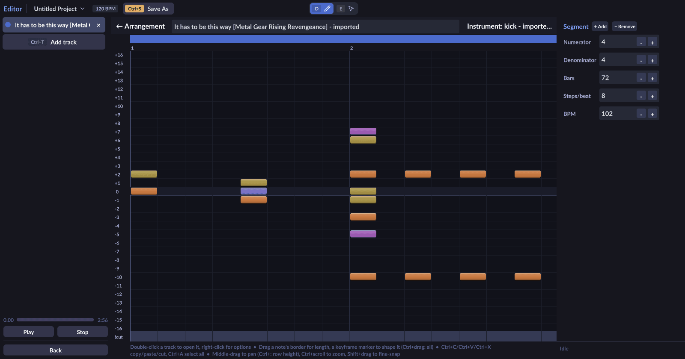

Sundex is a .NET 10 game and UI framework built on OpenTK.
It started out as the engine of Thirty Dollar Visualizer, but was extracted to what you now see.

It contains everything needed to build the Thirty Dollar Visualizer and other games you might want to do. 
It's still 2D only, but it will be later adapted to 3D games as well. 

For more info on each component, reference their specific documentation.

## Projects using Sundex

### Thirty Dollar Visualizer

[Thirty Dollar Visualizer](https://github.com/t1stm/ThirtyDollarTools) plays sequences from the
[Thirty Dollar Website](https://thirtydollar.website/) at note densities the website can't keep up
with, while keeping the same look and adding different features like a custom DAW-like editor and
some other game modes. Its editor arranges sequences on tracks, either as a piano
roll or event by event. Sundex draws the sound grid as GPU instances and builds the editor from its
components and markup.

### musicrain

[musicrain](https://github.com/t1stm/musicrain/tree/master/Native) is a self-hosted music service. Its
desktop client mirrors the web frontend in Sundex Markup 2.0 documents, which `Sundex.Markup.Generator`
compiles to C# at build time, and plays audio through Sundex's audio API.

## Building

Build and test with `dotnet build` and `dotnet test`.

See [BUILDING.md](BUILDING.md) for build instructions and how to start a new app.

## Acknowledgments

Text is drawn with the [Slug algorithm](https://github.com/EricLengyel/Slug) by Eric Lengyel. The
text shader is translated from his reference shaders (MIT, Copyright 2017 Eric Lengyel).

`background-blur` is the dual Kawase blur from [picom](https://github.com/yshui/picom) (MPL-2.0,
Copyright Yuxuan Shui). Its sample patterns come from `src/backend/gl/blur.c`, and its 20
strength levels from `src/backend/backend_common.c`.

Audio is played by a wrapper of [miniaudio](https://github.com/mackron/miniaudio) by David Reid