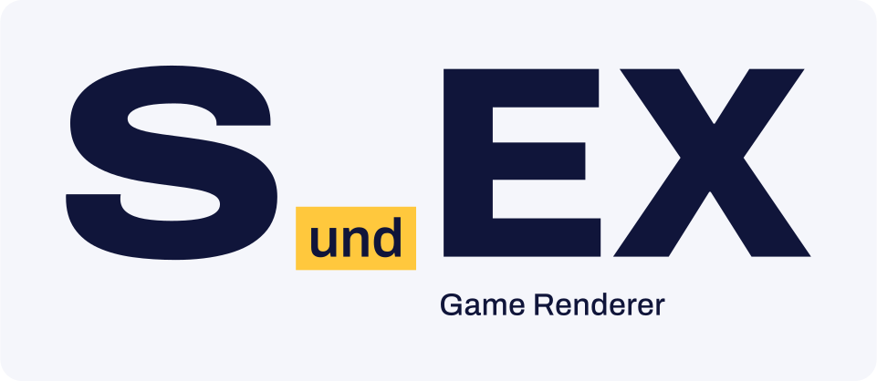
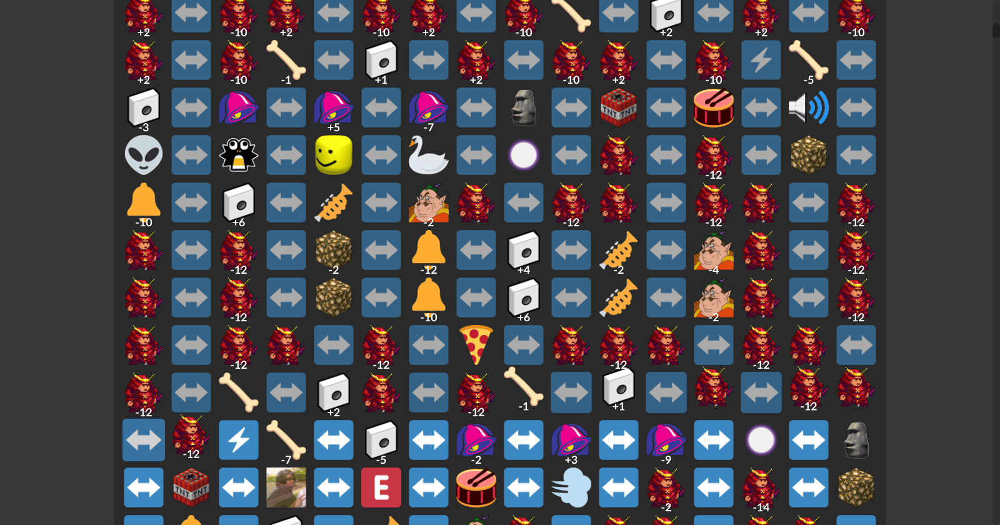
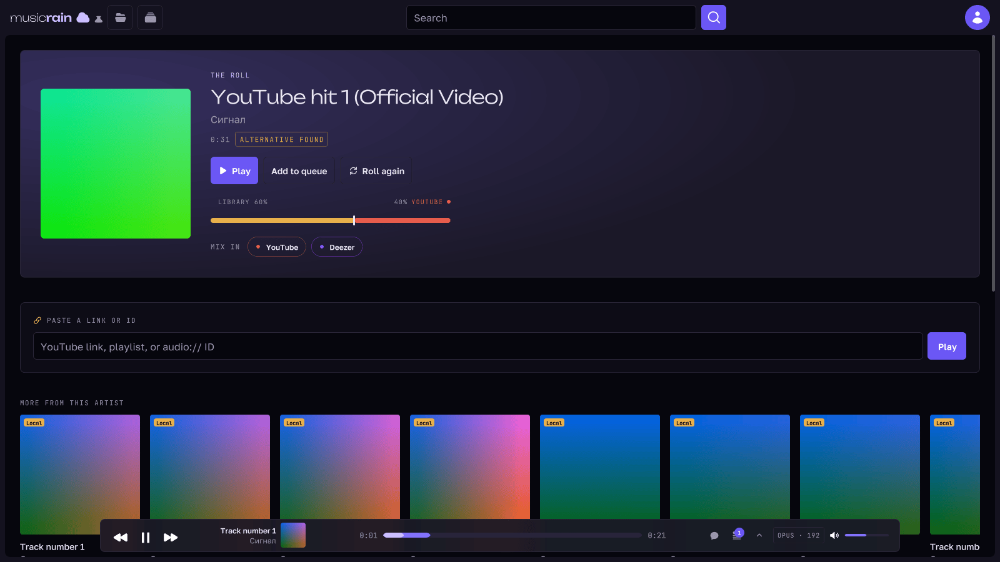
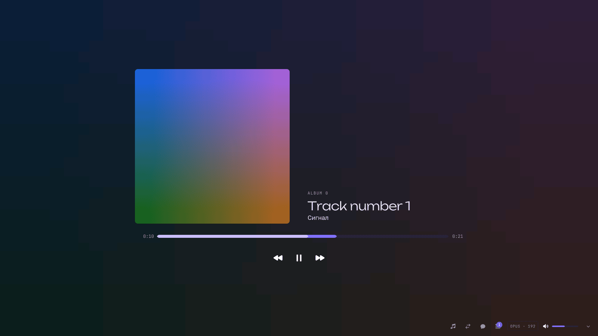

Sundex is a .NET 10 game and UI framework built on OpenTK. Reference `Sundex.Core` for a
game with planes, text and a scene loop. The Core package brings Engine, Slug and Reactive.

`Sundex.Style.DSL`, `Sundex.Components` and `Sundex.Markup` add styling, UI controls and
compiled markup. Reference `Sundex.Markup.Legacy` and call
`Sundex.Markup.Legacy.CSharp.Register()` at startup to run C# logic in
Sundex 1.0 markup. `Sundex.Testing` provides a headless UI context and mock font providers.

## Projects using Sundex

### Thirty Dollar Visualizer

[Thirty Dollar Visualizer](https://github.com/t1stm/ThirtyDollarTools) plays sequences from the
[Thirty Dollar Website](https://thirtydollar.website/) at note densities the website can't keep up
with, while keeping the same look and adding different features like a custom DAW-like editor and
some other game modes. Its editor arranges sequences on tracks, either as a piano
roll or event by event. Sundex draws the sound grid as GPU instances and builds the editor from its
components and markup.

### musicrain

[musicrain](https://github.com/t1stm/musicrain/tree/master/Native) is a self-hosted music service. Its
desktop client mirrors the web frontend in Sundex Markup 2.0 documents, which `Sundex.Markup.Generator`
compiles to C# at build time, and plays audio through BASS.

## Building

Build and test with `dotnet build` and `dotnet test`.

See [BUILDING.md](BUILDING.md) for build and browser-WASM publishing instructions.

## Acknowledgments

Text is drawn with the [Slug algorithm](https://github.com/EricLengyel/Slug) by Eric Lengyel. The
text shader is translated from his reference shaders (MIT, Copyright 2017 Eric Lengyel).

`background-blur` is the dual Kawase blur from [picom](https://github.com/yshui/picom) (MPL-2.0,
Copyright Yuxuan Shui). Its sample patterns come from `src/backend/gl/blur.c`, and its 20
strength levels from `src/backend/backend_common.c`.
